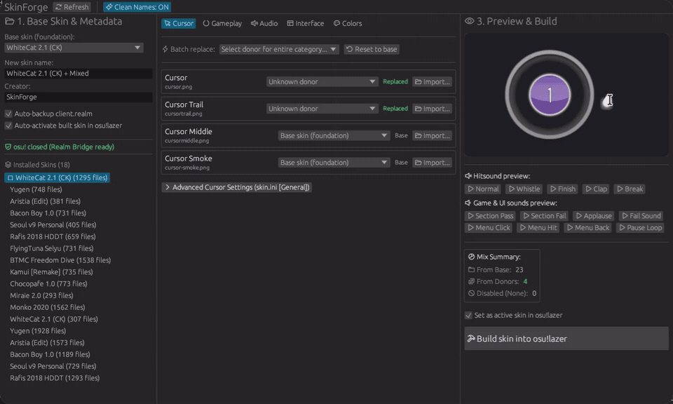

<div align="center">

# SkinForge

**Mix osu!lazer skins in a few clicks: take the cursor from one skin, hitsounds from another, and build a new skin with a live preview.**

[](https://github.com/RiaLnN/SkinForge/releases/latest)
[](LICENSE)




</div>

---

## Why SkinForge?

osu!stable has OsuMixer for combining skins, but **osu!lazer has nothing like it**. In lazer, skins live inside a Realm database (`client.realm`), so mixing them used to mean exporting and re-importing `.osk` files by hand.

SkinForge works with that database directly: pick a base skin, choose donors for individual elements, check the result in the preview, and click **Build**. The new skin shows up in lazer's settings right away.

## Features

- **Mix any element.** Swap the cursor, trail, hitcircle, hitsounds, interface elements and combo colours from different skins. A **Batch replace** dropdown swaps a whole category in one click.
- **Live preview.** A 60 fps canvas shows approach circles, combo colour tinting, hitcircle overlays and cursor movement with trails.
- **Hitsound audition.** Play hitnormal, whistle, finish, clap and combobreak before building.
- **Safe by design.** SkinForge refuses to write while osu! is running and makes a timestamped backup of `client.realm` before every change.
- **No wasted disk space.** New skins reference files lazer already stores, so nothing is copied.
- **CLI included** for scripting and inspection.

## Download

1. Open the [**Releases page**](https://github.com/RiaLnN/SkinForge/releases/latest).
2. Download the archive for your system:

| Platform | Archive |
| --- | --- |
| Windows (64-bit) | `skinforge-vX.Y.Z-windows-x64.zip` |
| Linux (64-bit) | `skinforge-vX.Y.Z-linux-x64.tar.gz` |

3. Extract it anywhere. **Keep all files together**, especially the `bridge/` folder: SkinForge needs it at runtime.

No .NET SDK or Rust toolchain is required.

> **Windows:** SmartScreen may warn about an unrecognized app because the binaries are not code-signed. If you downloaded from the official Releases page, click **More info → Run anyway**.

## Quick start

1. Run `skinforge` (`skinforge.exe` on Windows). If you choose direct Realm injection, ensure osu!lazer is closed; the recommended `.osk` import method works even while the game is running!
2. Choose a **Base skin** on the left.
3. Enter a name and author for the new skin.
4. In the tabs (**Cursor**, **Gameplay**, **Audio**, **Interface**, **Colors**), pick a donor skin for each element you want to change. Choose `Disable / Remove (None)` to drop optional elements such as `cursormiddle` or `combobreak`.
5. Check the result in the right panel: move the mouse over the canvas and click the audio buttons.
6. Click **Build skin into osu!lazer** and select your installation method:
   - **.osk package (Recommended)**: 100% database-safe, packages a standard skin archive, and launches it directly into osu!lazer. Works while the game is running.
   - **Direct injection into `client.realm` (Zero-copy)**: Instantly writes references without duplicating disk space. Requires osu!lazer to be closed to prevent database lock conflicts.
7. Enjoy your newly mixed skin in osu!lazer!

## Compatibility

| | Status |
| --- | --- |
| osu!lazer | Tested with `2026.1005.0-lazer` (Realm database schema v52) |
| Realm .NET SDK | `20.1.0` (Dynamic API) |
| Windows 10/11 (x64) | Supported |
| Linux (x64, including Flatpak) | Supported |
| macOS | Not supported |

SkinForge connects to osu!lazer's database using Realm's Dynamic API, inspecting and patching the schema without compiling against lazer's internal classes. This ensures compatibility across updates as long as the core `Skin` and `File` models remain structurally compatible. If an osu!lazer update ever breaks SkinForge, please [open an issue](https://github.com/RiaLnN/SkinForge/issues) with your lazer version.

## Is it safe?

SkinForge prioritizes data integrity and offers two distinct installation pathways:

1. **.osk packaging (Default & Recommended)**: Generates a standard `.osk` skin archive into `exports/` and forwards it to osu!lazer. The game's native importer validates and ingests the skin. This never writes to `client.realm` directly, preventing database lock collisions and corruption even while the game is open.
2. **Direct Realm injection**: For users who prefer instant zero-copy installation without duplicating storage. SkinForge takes strict safety precautions:
   - Enforces that osu! is closed before any database modification.
   - Creates a timestamped backup of `client.realm` (along with `.lock`, `.note`, and `.management` if present) as `client.realm.bak-<timestamp>` before modifying anything.
   - Executes changes within an atomic Realm transaction.

To restore a Realm backup manually, close osu! and copy the backup over `client.realm`.

## Command line

`skinforge-cli` is included for scripting and inspection:

```bash
skinforge-cli check-running                 # is osu! running?
skinforge-cli find-lazer                    # print lazer's root, database and storage paths
skinforge-cli dump-skins \                  # dump installed skins as JSON
  --bridge-binary ./bridge/realm-bridge \
  --db ~/.local/share/osu/client.realm
skinforge-cli inspect-donor /path/to/skin   # list components of a donor skin folder
```

## Troubleshooting

**"osu! is running" warning won't go away.**
Make sure lazer is fully closed, including background processes and Flatpak wrappers. SkinForge rechecks every 2 seconds and enables the Build button as soon as the game exits.

<details>
<summary><b>The Linux GUI does not start</b></summary>

Install the required GTK 3 and graphics libraries:

```bash
sudo apt-get install -y libxcb-render0-dev libxcb-shape0-dev libxcb-xfixes0-dev \
  libxkbcommon-dev libssl-dev libasound2-dev libgtk-3-dev
```

</details>

<details>
<summary><b>How does it avoid copying files?</b></summary>

lazer stores files by SHA-256 hash in its `files/` folder. When you take a cursor from skin A into skin B, SkinForge adds a reference to the existing hash in the new skin instead of duplicating the file.

</details>

## For developers

Architecture and repository layout are described in [docs/ARCHITECTURE.md](docs/ARCHITECTURE.md).

Prerequisites: [Rust](https://rustup.rs/) (1.80+) and the [.NET 8 SDK](https://dotnet.microsoft.com/download).

```bash
dotnet build realm-bridge/realm-bridge.csproj -c Release   # C# Realm bridge
cargo build --release --workspace                          # Rust workspace

cargo run --release -p skinforge-gui                       # run the GUI
cargo run --release -p skinforge-core -- --help            # run the CLI
```

## Contributing

Bug reports, ideas and pull requests are welcome. When reporting a bug, please include your OS, osu!lazer version, SkinForge version and steps to reproduce.
[Issues](https://github.com/RiaLnN/SkinForge/issues).

## Support

If you find SkinForge helpful, you can support its development here:

[](https://ko-fi.com/rialnn)

## License

[MIT](LICENSE)
