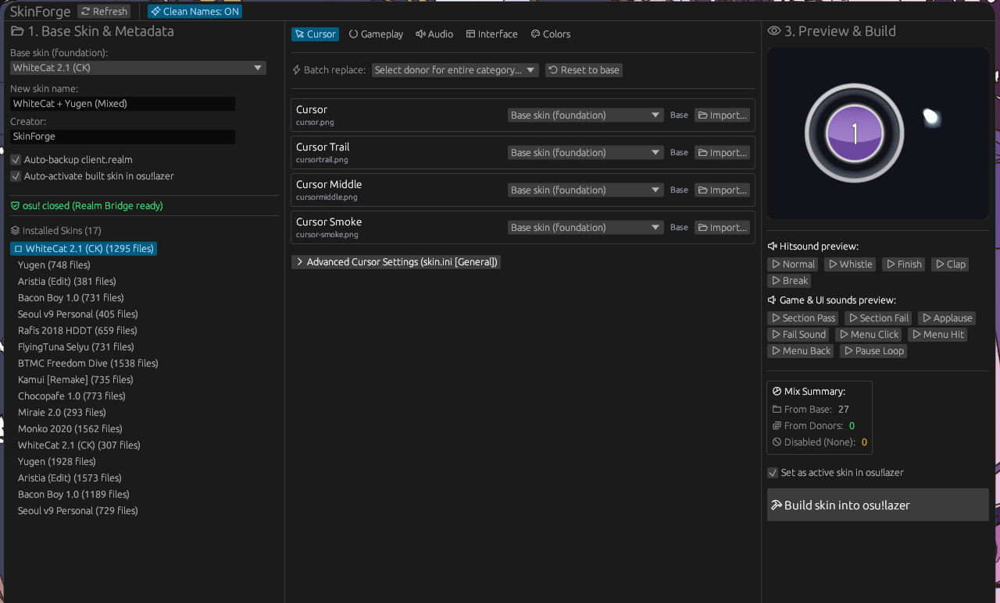

<div align="center">

# SkinForge

**Mix and customize osu!lazer skins with real-time preview and zero-copy performance.**

[](https://github.com/RiaLnN/SkinForge/releases/latest)
[](https://github.com/RiaLnN/SkinForge/releases)
[](LICENSE)



    
</div>

---

## What is SkinForge?

In **osu!lazer**, skins are stored inside a Realm database (`client.realm`) with resources tracked in content-addressed storage (`files/`). Unlike osu!stable where skins are plain folders on disk, mixing skins in lazer previously required cumbersome manual `.osk` export/import cycles or risking database corruption.

**SkinForge** solves this natively:
- **Direct Database Integration**: Reads your installed skins library instantly via a high-performance C# Realm Dynamic API bridge.
- **Zero-Copy Asset Mapping**: New mixed skins reference existing file hashes in lazer's storage. No disk space duplication.
- **Interactive Live Preview**: 60fps canvas displaying animated approach circles, hitcircle combo colour tinting, hitcircle overlays, and responsive cursor movement with trails.
- **In-App Hitsound Audition**: Play hitnormal, whistle, finish, clap, and combobreak sounds on demand before building.
- **Fail-Safe Database Protection**: Built-in process detection prevents concurrent writes while osu! is open. Automatic timestamped backups (`client.realm.bak-<timestamp>`) ensure you can always restore your database.

---

## Download

1. Visit the [**Releases page**](https://github.com/RiaLnN/SkinForge/releases/latest).
2. Download the release archive for your operating system:

| Platform | Archive | Contents |
| --- | --- | --- |
| Windows (64-bit) | `skinforge-vX.Y.Z-windows-x64.zip` | GUI app, CLI tool, Realm bridge, docs |
| Linux (64-bit) | `skinforge-vX.Y.Z-linux-x64.tar.gz` | GUI app, CLI tool, Realm bridge, docs |

3. Extract the archive anywhere. **Keep all files together**, particularly the `bridge/` folder which is required at runtime.

No .NET SDK or Rust toolchain installation is needed for release builds.

> **Windows note:** SmartScreen may display an unrecognized application prompt because binaries are not digitally code-signed. Click **More info → Run anyway** if you downloaded from the official Releases page.

---

## Quick Start (GUI)

1. **Close osu!lazer** so `client.realm` is unlocked.
2. Launch `skinforge` (`skinforge.exe` on Windows).
3. In the left panel, select your **Base skin** (the foundation for all default assets).
4. Enter a name and author for the new skin.
5. In the central tabs (**Cursor**, **Gameplay**, **Audio**, **Interface**, **Colors**):
   - Choose donors for individual slots (e.g. cursor, trail, hitcircle, hitnormal).
   - Use the **Batch replace** dropdown to swap an entire category from one donor with 1 click.
   - Disable optional elements (such as `cursormiddle` or `combobreak`) by choosing `Disable / Remove (None)`.
   - Customize combo colours in the **Colors** tab.
6. Verify your mix in the right panel:
   - Move your mouse over the canvas to test cursor behavior.
   - Click the audio buttons to test hitsound replacements.
7. Click **Build skin into osu!lazer**.
8. Launch osu!lazer — your new skin is immediately selectable in settings!

---

## Command-Line Usage

SkinForge also includes `skinforge-cli` for scriptable inspections and headless workflows:

```bash
# Check if osu! is running
skinforge-cli check-running

# Find and print osu!lazer paths (root, database, storage)
skinforge-cli find-lazer

# Dump installed skins metadata to JSON
skinforge-cli dump-skins \
  --bridge-binary ./bridge/realm-bridge \
  --db ~/.local/share/osu/client.realm

# Inspect components of a donor skin directory
skinforge-cli inspect-donor /path/to/donor-skin
```

---

## FAQ & Troubleshooting

**Will SkinForge corrupt my osu!lazer library?**  
No. SkinForge protects your library with multiple safety layers:
1. It validates that osu! is closed before performing write operations.
2. It makes a full timestamped copy of `client.realm` (including `.lock`, `.note`, and `.management` if present) before executing any patch.
3. Patch transactions in Realm are fully atomic.

**How does zero-copy work?**  
osu!lazer identifies files by SHA-256 hash in its `files/` storage. When you mix a cursor from Skin A into Skin B, SkinForge simply adds a pointer to the existing hash in your new skin manifest. No additional storage space is consumed.

**osu! is running (locked) warning won't go away.**  
Make sure osu!lazer is completely closed, including any background processes or flatpak wrappers. SkinForge checks process status every 2 seconds and will automatically enable the build button once the game exits.

**The Linux GUI does not start.**  
Ensure standard GTK 3 and graphics development libraries are present on your system:
```bash
sudo apt-get install -y libxcb-render0-dev libxcb-shape0-dev libxcb-xfixes0-dev libxkbcommon-dev libssl-dev libasound2-dev libgtk-3-dev
```

---

## For Developers

### Architecture

```text
osu!lazer client.realm ──(realm-bridge, C# .NET 8)──> JSON metadata
                                                            │
                                                     (skinforge-core, Rust)
                                                            │
                                            ┌───────────────┴───────────────┐
                                            ▼                               ▼
                                   (skinforge desktop GUI)        (skinforge-cli)
                                   egui + live canvas             headless CLI
```

### Repository Structure

```text
Osu-mixer-lazer/
├── crates/
│   ├── core/                   # Rust core library & CLI (paths, process guard, mixer, parser)
│   └── gui/                    # Desktop GUI (egui + eframe, live canvas, audio preview)
├── realm-bridge/               # High-performance C# Realm Dynamic API bridge (.NET 8)
├── packaging/                  # Bundled release files & instructions
├── .github/workflows/          # CI and multi-platform release workflows
├── Cargo.toml                  # Cargo workspace definition
└── LICENSE                     # MIT License
```

### Building from Source

Prerequisites:
- [Rust](https://rustup.rs/) (1.80+ or latest stable)
- [.NET 8 SDK](https://dotnet.microsoft.com/download)

```bash
# 1. Build the C# Realm bridge
dotnet build realm-bridge/realm-bridge.csproj -c Release

# 2. Build the Rust workspace
cargo build --release --workspace
```

Run directly from source:
```bash
# Run desktop GUI
cargo run --release -p skinforge-gui

# Run CLI
cargo run --release -p skinforge-core -- --help
```

---

## Contributing

Bug reports, suggestions, and pull requests are warmly welcome! Please submit an issue on GitHub describing your operating system, version, and steps to reproduce.

---

## License

[MIT](LICENSE)
